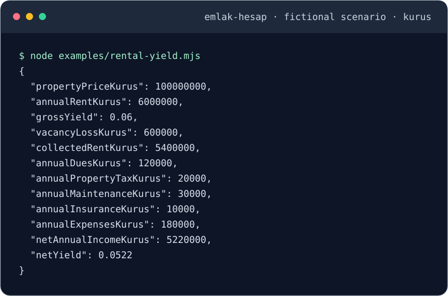

# emlak-hesap

[](https://github.com/YusufBeratZengin/emlak-hesap/actions/workflows/ci.yml) [](https://www.npmjs.com/package/emlak-hesap) [](LICENSE) [](package.json) [](package.json)

English · [Türkçe](README.tr.md) · ESM · Node.js 20+

A TypeScript library and English/Turkish browser calculator for housing investment and purchase costs in Türkiye.



## Why emlak-hesap?

- **Traceable money calculations:** integer kuruş, explicit rounding and itemized results that reconcile with payment schedules.
- **Visible assumptions:** pure typed functions, explicit fee inputs and dated reference presets you opt into.
- **Local by design:** zero runtime dependencies, no network calls and an English/Turkish browser calculator that keeps inputs in memory.

## Quick start

With Node.js 20+ and npm, start from a checkout of this repository:

```sh
npm ci --ignore-scripts
npm run build
node examples/rental-yield.mjs
```

The last command prints the JSON shown above: `grossYield: 0.06` (6%) and `netYield: 0.0522` (5.22%). Run `npm run examples` for all three examples. To regenerate the image from real console output, run `npm run demo`; CI checks that it stays current.

## Demo

Try all seven calculation tabs in the [browser calculator](https://YusufBeratZengin.github.io/emlak-hesap/). Inputs stay in memory. The demo is available once GitHub Pages deployment is enabled for this repository.

### Sample output

Actual console output from `netRentalYield` via `node examples/rental-yield.mjs` (fictional scenario; amounts in kuruş):

```json
{
  "propertyPriceKurus": 100000000,
  "annualRentKurus": 6000000,
  "grossYield": 0.06,
  "vacancyLossKurus": 600000,
  "collectedRentKurus": 5400000,
  "annualDuesKurus": 120000,
  "annualPropertyTaxKurus": 20000,
  "annualMaintenanceKurus": 30000,
  "annualInsuranceKurus": 10000,
  "annualExpensesKurus": 180000,
  "netAnnualIncomeKurus": 5220000,
  "netYield": 0.0522
}
```

## Installation

After the first npm publication:

```sh
npm install emlak-hesap
```

The npm version badge and registry install may be unavailable before the first release. Until then, use the checkout commands in [Quick start](#quick-start).

The package is ESM and requires Node.js 20+. Runtime dependencies: none. There are no network calls in the library or calculator, analytics, remote fonts, or saved financial inputs. Source links open only when followed.

## Usage examples

Run `npm run examples` for [rental yield](examples/rental-yield.mjs), [mortgage](examples/mortgage.mjs) and [purchase costs](examples/purchase-cost.mjs). They import the built package, use fictional inputs, print deterministic results and also run under `npm run test:smoke`.

### Library example

```ts
import { grossRentalYield, mortgage, purchaseCost } from 'emlak-hesap';
import { tr2026 } from 'emlak-hesap/presets/tr-2026';

// Fictional scenario. All library amounts are integer kuruş: 100 kuruş = 1 TL.
const yieldResult = grossRentalYield({
  propertyPriceKurus: 100_000_000, // 1,000,000 TL
  monthlyRentKurus: 500_000,      // 5,000 TL
});
console.log(yieldResult.grossYield); // 0.06 = 6%

const loan = mortgage({
  principalKurus: 10_000,
  monthlyInterestRate: 0.01, // monthly, not annual: 0.01 = 1%
  months: 2,
  bsmvRate: 0,
  kkdfRate: 0,
});
console.log(loan.monthlyPaymentKurus, loan.totalInterestKurus); // 5075, 150

// Opt in explicitly. Verify all reference rates; obtain quotes for fixed charges.
const acquisition = purchaseCost({
  ...tr2026.purchase,
  propertyPriceKurus: 100_000_000,
  deedFeeBaseKurus: 100_000_000,
  revolvingFundKurus: 100_000, // fictional quote, not a statutory tariff
  appraisalKurus: 50_000,
  daskKurus: 20_000,
});
console.log(acquisition.buyerTotalKurus); // 104570000
```

## API summary

Every function is pure, accepts one object, returns an itemized object, and leaves inputs untouched. Types and result interfaces are exported from the package root. `Kurus` fields are safe integers; rates and yield results are decimal ratios (`0.02 = 2%`). Web forms instead accept TL and percent (`2 = 2%`).

| Function | Input fields | Main outputs / behavior |
| --- | --- | --- |
| `grossRentalYield` | `propertyPriceKurus`, `monthlyRentKurus` | `annualRentKurus`, `grossYield = annual rent / price` |
| `netRentalYield` | Gross inputs + `monthlyDuesKurus`, `annualPropertyTaxKurus`, `annualMaintenanceKurus`, `vacancyRate`, `annualInsuranceKurus` | Gross breakdown, vacancy loss, collected rent, individual costs, `annualExpensesKurus`, `netAnnualIncomeKurus`, `netYield` |
| `paybackPeriod` | `investmentKurus`, `monthlyRentKurus`, optional `annualRentGrowthRate = 0`, `maxYears = 100` | `years` (fractional, or `null`), `recovered`, initial annual rent, whole-year `schedule` |
| `mortgage` | `principalKurus`, `monthlyInterestRate`, `months`, optional `bsmvRate = 0`, `kkdfRate = 0` | All-in `monthlyPaymentKurus`, `finalPaymentKurus`, payment/interest/tax totals and monthly `schedule` |
| `purchaseCost` | `propertyPriceKurus`, `deedFeeBaseKurus`, `buyerDeedFeeRate`, `sellerDeedFeeRate`, `revolvingFundKurus`, `agentFeeRate`, `agentVatRate`, `buyerAgentShare`, `appraisalKurus`, `daskKurus` | Separate buyer/seller deed and agent fees, VAT, fixed charges, `buyerCostsKurus`, `sellerCostsKurus`, transaction costs, `buyerTotalKurus`, seller net proceeds |
| `realReturn` | `nominalReturnRate`, `inflationRate` | Input rates and `realReturnRate = (1 + nominal) / (1 + inflation) - 1` |
| `pricePerSqm` | `propertyPriceKurus`, `areaSqm` | `pricePerSqmKurus`, rounded to kuruş/m² |
| `comparePricePerSqm` | Price inputs + `regionalAverageKurus` (kuruş/m²) | Rounded unit price, `differenceKurus`, `differenceRate = (unit price - average) / average` |
| `rentVsBuy` | `propertyPriceKurus`, `monthlyRentKurus`, `purchaseCostsKurus`, `annualOwnershipCostsKurus`, `annualOpportunityRate`, `years` | Rent/ownership/opportunity cost totals, committed capital, `rentMinusBuyKurus`, `lowerCostOption: 'rent' \| 'buy' \| 'equal'` |

See [source and exported interfaces](src/index.ts) and [worked numerical tests](tests/calculations.test.ts). Mortgage rows include opening balance, payment, principal, interest, BSMV, KKDF and closing balance, all in kuruş.

## Configuration

There are no environment variables, credentials or configuration files. Pass amounts and rates directly to each function. The optional `tr2026` preset is imported separately and never applied automatically; override its fields explicitly for your scenario. In the browser, choose the language and theme and edit the form inputs.

### Money and validation

- Pass non-negative safe-integer kuruş amounts; fractional TL must be converted before calling the library. Prices, principal, investment, deed fee base, area and regional average must be positive.
- Non-finite numbers, invalid ranges and unsafe monetary results throw `RangeError` with English messages. Rates are non-negative and at most `1`, except nominal return and inflation, which may exceed `1`. Negative scenario rates (including deflation and nominal losses) are not supported in 0.1.0. Calculated results may be negative.
- Months must be integers in `1–1200`; years in `1–1000`. These bounds also limit schedule sizes. An unrecovered payback is `null`, never infinity.
- Multiplication/division use the exact decimal spelling of numeric inputs and BigInt arithmetic before rounding **half away from zero to the nearest kuruş**. For example, `100 * 0.145` is rounded to `15`, even though native floating-point multiplication falls just below `14.5`. Rounding is per charge; an odd commission kuruş is assigned by rounding the buyer share and giving the seller the remainder.
- Annuity factors and ratio results use floating point. Interest and each interest tax are rounded separately per month. The last payment clears the remaining principal, so it can differ from the target annuity. Very small loans can repay early or have irregular payments due to rounding; schedule rows always cover the requested term and never have negative principal. Totals reconcile with the table. Overflow is rejected rather than clamped.

## Web calculator

```sh
npm run build:web
python -m http.server 8080 --directory web/dist
```

Open `http://localhost:8080`. The generated `web/dist` has relative asset paths and can be hosted at a GitHub Pages project subpath. The server is a local preview command, not part of the library. Source files live in [`web/`](web/); translations are in [`en.json`](web/locales/en.json) and [`tr.json`](web/locales/tr.json).

The framework-free interface includes seven tabs covering all calculations, English/Turkish switching, locale-aware TRY formatting with `Intl`, light/dark themes, keyboard tab navigation, labeled forms, inline validation and a mortgage table. Fictional starting scenarios are editable. Inputs survive tab/language changes in memory and disappear on reload; financial data is never stored. Changed inputs visibly mark existing results as stale.

The [Pages workflow](.github/workflows/pages.yml) runs **only on pushes to `main`**, checks the project, then deploys `web/dist`. In repository settings, select **Pages → Source → GitHub Actions** before using it. No deployment or npm publication is performed by the local build.

## FAQ and limitations

### Does it fetch market data or save inputs?

No. Supply your own prices, rents and rates. The browser keeps inputs only in memory until reload; the library makes no network calls.

### Why does the npm badge show no version?

The registry badge becomes available after the first npm publication. The source checkout works before publication; see [Quick start](#quick-start).

### Which assumptions affect the results?

**This is not legal, tax or financial advice.** Results are planning estimates, not offers, valuations or guaranteed returns. Verify inputs and applicable rules with qualified professionals.

- Net rental yield includes only the specified owner-paid costs and vacancy; it excludes income tax, acquisition fees and financing. Full vacancy can produce a negative net yield.
- Payback uses undiscounted rental cash flows only, increases rent at each year anniversary and interpolates the recovery fraction within the final year. Its schedule contains full annual cash flows; the last full year may exceed the recovery amount. It excludes costs and resale value.
- Mortgage uses `P*r / (1 - (1+r)^-n)` with monthly `r = monthlyInterestRate * (1 + bsmvRate + kkdfRate)`. BSMV/KKDF default to zero as modeling parameters; this does **not** establish exemption or determine which taxes apply. Bank fees, insurance, grace periods and variable rates are excluded.
- Purchase fees have **no built-in legal rates** in the calculation. The deed base is explicit; the calculator does not establish its statutory minimum. Agent rate is the **total** before VAT; VAT is charged on that fee. `buyerAgentShare` allocates the VAT-inclusive total. Fixed charges go to the buyer in this simplified model. Exemptions, property-sale VAT, capital gains and other transaction charges are not inferred.
- `rentVsBuy` models an all-cash purchase with constant rent and retained home value. Buying economic cost = upfront fees + annual ownership costs × years + `(price + upfront fees) × opportunity rate`, rounded annually, × years. The home price is not treated as a loss because the asset is retained. No loan, appreciation, rent growth, compounding, sale costs or full portfolio simulation is included. Positive `rentMinusBuyKurus` means buying has the lower modeled cost.
- Fisher rates must cover the same period. Area comparisons require consistent net/gross area definitions and a user-supplied regional estimate; no market data is fetched.

Follow the [official-source verification and rate update checklist](docs/rates-update.md); tests fail after 18 calendar months without a new review. Freshness does not guarantee legal correctness.

### Dated Turkish reference preset

[`src/presets/tr-2026.ts`](src/presets/tr-2026.ts) is an **opt-in reference snapshot dated 2026-10-22; rates may change and must be verified**. It uses 2% deed fees per party, the 4% total brokerage ceiling before VAT, a 50/50 allocation assumption and 20% general VAT for the brokerage scenario. The ceiling is not a mandatory fee. Fixed charges are zero because a quote is required, not because they are free. The preset includes source comments:

- [GİB deed fee information](https://cdn.gib.gov.tr/api/gibportal-file/file/getFileResources?objectKey=arsiv%2Fyardim-kaynaklar%2Finfografikler%2Fpdfs%2Ftapuharci.pdf): separate buyer and seller rates and the fee base.
- [Ministry of Trade regulation, Article 20](https://eskisehir.ticaret.gov.tr/data/64edb08513b876171c69c106/TA%C5%9EINMAZ%20T%C4%B0CARET%C4%B0%20HAKKINDA%20Y%C3%96NETMEL%C4%B0K%20.pdf): total brokerage ceiling and allocation.
- [GİB VAT rate reference](https://cdn.gib.gov.tr/api/gibportal-file/file/getFileResources?objectKey=arsiv%2Fyardim-kaynaklar%2Fyararli-bilgiler%2Fkdv-oranlari.pdf): general VAT rate, Decision 7346, effective 2023-07-10. Confirm applicability to the service.

## Contributing

```sh
npm run check          # strict types, ESLint, Vitest + coverage, both builds, secret scan
npm run test:smoke     # compiled package tests and runnable examples
```

`npm test` prints coverage as well as test results. Vitest checks hand-calculated examples, every public function's invalid inputs, rounding, boundaries, schedule reconciliation and the bilingual DOM interface. Coverage is written to `coverage/` (HTML and LCOV); enforced library thresholds: 95% lines/statements, 100% functions, 90% branches. The [CI workflow](.github/workflows/ci.yml) tests Ubuntu with Node 20, 22 and 24 and Windows with Node 22 and 24, prints coverage and uploads the reports. The CI badge shows the live workflow status.

See [CONTRIBUTING.md](CONTRIBUTING.md) for the workflow, privacy rules and pre-commit secret scan, and [CHANGELOG.md](CHANGELOG.md) for release notes.

Read the [private security reporting policy](SECURITY.md) and [code of conduct](CODE_OF_CONDUCT.md). Release steps are in the “Releasing” section of CONTRIBUTING.md.

## License

Released under the [MIT license](LICENSE).
